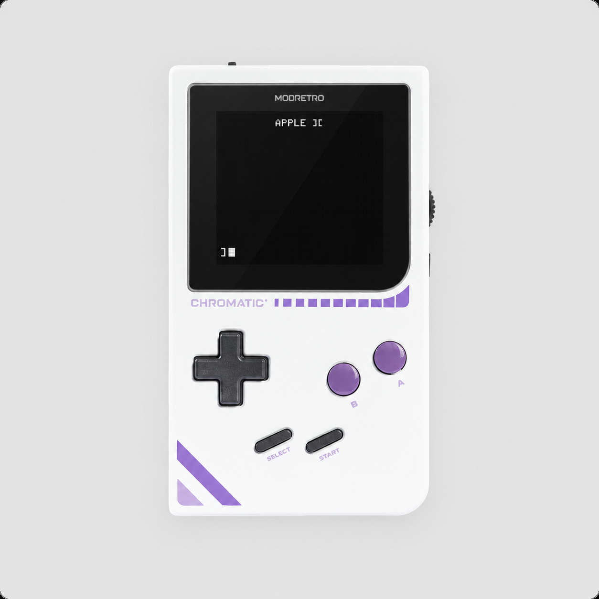

# Apple II on Chromatic

*Illustrative AI composite using [ModRetro’s stock product image](https://modretro.com/cdn/shop/files/Chr_Cloud.png?v=1779222065&width=1600); not a device screenshot.*

A small Apple II environment for the ModRetro Chromatic. The ESP32 runs the CPU,
48 KiB of emulated RAM, graphics and Disk II emulation. An original FPGA design
connects the display, buttons, speaker and cartridge.

- Applesoft BASIC and DOS 3.3, using externally supplied ROMs and disk images.
- 40-column text, 16-color lores and monochrome high-resolution graphics.
- Cartridge-backed floppy images with persistent `SAVE`/`LOAD` changes.
- A handheld program browser, on-screen keyboard and pause/resume menu.
- An encrypted SSH terminal for typing from a computer.
- Wi-Fi setup from a phone or computer, with existing-network and WPA2 hotspot modes.
- Approximately 1.023 MHz emulated CPU speed and partial display updates; see
  [measured performance](docs/verification.md). Disk service can pause emulation.

This is a working hardware project with a narrow tested target: one OpenAI DevDay
Chromatic containing an ESP32-U4WDH and GW5A-EV25UG256CC1/I0 FPGA, with a 4 MiB
ISSI IS29GL032 cartridge. Other board revisions, panels and cartridges need their
own validation. USB and Bluetooth keyboards connected directly to the handheld
are currently unsupported; a computer keyboard works through SSH.

The owner confirmed color animation, Breakout output and the physical MENU
button on the display. Automated device tests cover BASIC, disk persistence,
program launch and SSH. Codec configuration and digital audio transport were
checked; speaker listening remains unverified. See the
[verification record](docs/verification.md) for the distinction.

Start with the [build guide](docs/build.md) and [Wi-Fi setup](docs/wifi.md), then read
[installation and recovery](docs/install.md) before programming hardware.
[Controls, disks and the local API](docs/usage.md) cover everyday use.
The [sharing guide](docs/sharing.md) explains preparing your own public copy.
All commands run from this repository's root.

The repository builds a small original diagnostic without Apple ROMs. Full BASIC
and DOS operation require your own ROM and disk inputs. Credentials, raw device
backups and firmware built with private inputs belong in ignored build folders.

Project code is provided under [MIT](LICENSE). Reused MII, LittleFS and SSH
components retain their notices; see [third-party notices](THIRD_PARTY_NOTICES.md).
Externally supplied ROMs and disk contents retain their own rights and are not
included in the source distribution.
